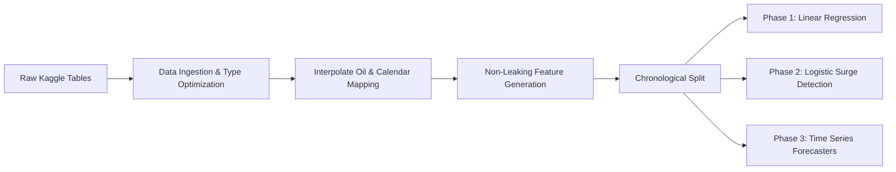

# Retail Sales Prediction and Forecasting

[](https://www.python.org/)
[](https://opensource.org/licenses/MIT)
[](https://www.kaggle.com/competitions/store-sales-time-series-forecasting)
[](#)

An end-to-end Machine Learning, Statistical Econometric, and Predictive Analytics system developed for university submission on the **Kaggle Store Sales — Time Series Forecasting** dataset (Corporación Favorita, Ecuador). The project investigates regression for continuous sales volume estimation, classification for high-demand surge detection and stockout prevention, and classical time-series models for enterprise-level multi-step forecasting.

---

## 📑 Table of Contents
- [1. Project Title & Overview](#1-project-title--overview)
- [2. Problem Statement & Objectives](#2-problem-statement--objectives)
- [3. Dataset Source & Description](#3-dataset-source--description)
- [4. Technologies & Libraries Used](#4-technologies--libraries-used)
- [5. Project Directory Structure](#5-project-directory-structure)
- [6. Data Preprocessing & Feature Engineering Overview](#6-data-preprocessing--feature-engineering-overview)
- [7. Modeling Architecture & The Three Phases](#7-modeling-architecture--the-three-phases)
  - [Phase 1: Linear Regression — Continuous Sales Prediction](#phase-1-linear-regression--continuous-sales-prediction)
  - [Phase 2: Logistic Regression — Demand Surge Classification](#phase-2-logistic-regression--demand-surge-classification)
  - [Phase 3: Time Series Modeling & Econometric Forecasting](#phase-3-time-series-modeling--econometric-forecasting)
- [8. Existing Experimental Results](#8-existing-experimental-results)
- [9. Explanation of Evaluation Metrics](#9-explanation-of-evaluation-metrics)
- [10. Installation & Environment Setup](#10-installation--environment-setup)
- [11. Commands to Run Each Modeling Pipeline](#11-commands-to-run-each-modeling-pipeline)
- [12. Explanation of Notebooks, Reports, Figures, and Saved Models](#12-explanation-of-notebooks-reports-figures-and-saved-models)
- [13. Current Limitations & Future Improvements](#13-current-limitations--future-improvements)
- [14. Academic Integrity & Data Hygiene](#14-academic-integrity--data-hygiene)
- [15. License & References](#15-license--references)

---

## 1. Project Title & Overview

**Project Title:** Retail Sales Prediction and Forecasting: Multi-Phase Machine Learning and Econometric Time Series Framework for Grocery Demand Analytics  
**Institution:** University Academic Project Submission  
**Domain:** Supply Chain Analytics, Retail Predictive Modeling, Econometrics  
**Dataset:** Corporación Favorita Grocery Store Sales (Ecuador) via Kaggle  

Modern grocery supply chains operate on thin margins, high SKU variety, and perishable product constraints. Accurate sales forecasting enables retail enterprises to maintain adequate on-shelf availability, optimize warehouse replenishment cycles, mitigate overstock holding costs, and eliminate avoidable food spoilage.

This project implements a three-phase predictive modeling system:
1. **Continuous Sales Volume Forecasting (Regression):** Predicts daily unit sales across $1,782$ distinct store-product family series using regularized linear regression formulations.
2. **Demand Surge Classification (Classification):** Detects probabilistically whether sales for a specific product family and store will exceed historical 80th-percentile surge levels, enabling proactive stockout intervention.
3. **Statistical & Econometric Time Series Forecasting (Univariate & Exogenous Forecasters):** Models macro-enterprise sales and micro-store demand using Seasonal Naive, Holt-Winters Exponential Smoothing, SARIMA, and SARIMAX architectures.

---

## 2. Problem Statement & Objectives

### 2.1 Problem Statement
Retail demand in large grocery chains is volatile, highly seasonal, and exposed to external macroeconomic shocks. Key operational challenges include:
- **Intra-week Demand Cyclicality:** High consumer grocery shopping traffic concentrated on weekends (+39.35% weekend demand lift over weekdays).
- **Payday Cash Inflows:** Bimonthly public and private salary payments in Ecuador occurring on the 15th and month-end create periodic demand surges (+1.41% average network lift).
- **Macroeconomic Volatility:** Ecuador operates a dollarized economy heavily reliant on crude oil exports; fluctuations in global oil prices directly influence consumer purchasing power.
- **Asymmetric Operational Costs:** Failing to predict a demand surge leads to stockouts, lost revenue, and damaged customer loyalty; over-predicting demand leads to excessive working capital tie-up and perishable goods spoilage.
- **Multi-Step Horizon Leakage:** Operational forecasting requires predicting 15 to 16 days into the future. Feature sets that utilize immediate past sales ($t-1$ through $t-15$) cannot be deployed in production without introducing catastrophic multi-step data leakage.

### 2.2 Core Objectives
1. **Leakage-Free Feature Engineering:** Construct temporal features, calendar indicators, and historical rolling window aggregations strictly honoring a $\ge 16$-day lag cutoff matching the 16-day Kaggle operational test horizon.
2. **Continuous Prediction Benchmark:** Implement and compare Ordinary Least Squares (OLS), Ridge ($L_2$), Lasso ($L_1$), and Elastic Net regularized linear regressions against empirical and seasonal naive baselines on $\log(1 + \text{sales})$ targets.
3. **Surge Detection Classification:** Formulate an 80th-percentile demand surge classification task using Logistic Regression, evaluating default thresholding, balanced class weighting, and out-of-sample calibrated decision thresholding.
4. **Econometric Time Series Benchmarking:** Fit and analyze statistical time-series forecasters (Seasonal Naive, Holt-Winters, SARIMA, SARIMAX) across enterprise-level aggregated demand and representative store-family cohorts.
5. **Physical & Operational Validity:** Ensure non-negative sales predictions via log-space target transformations and investigate the operational trade-offs between precision, recall, and holding costs.

---

## 3. Dataset Source & Description

The project utilizes data from the [Kaggle Store Sales — Time Series Forecasting Competition](https://www.kaggle.com/competitions/store-sales-time-series-forecasting), published by Corporación Favorita (a major grocery retailer in Ecuador).

### 3.1 Primary Data Tables
| File | Dimension / Size | Key Columns | Description |
| :--- | :--- | :--- | :--- |
| **`train.csv`** | 3,000,888 rows $\times$ 6 cols | `id`, `date`, `store_nbr`, `family`, `sales`, `onpromotion` | Daily sales data spanning Jan 1, 2013 to Aug 15, 2017 across 54 stores and 33 product families ($54 \times 33 = 1,782$ series). |
| **`test.csv`** | 28,512 rows $\times$ 5 cols | `id`, `date`, `store_nbr`, `family`, `onpromotion` | Out-of-sample operational test set spanning Aug 16, 2017 to Aug 31, 2017 (16 days $\times$ 1,782 series). |
| **`stores.csv`** | 54 rows $\times$ 5 cols | `store_nbr`, `city`, `state`, `type`, `cluster` | Store metadata covering 17 cities, 16 provinces, 5 store types (A, B, C, D, E), and 17 operational clusters. |
| **`oil.csv`** | 1,218 rows $\times$ 2 cols | `date`, `dcoilwtico` | Daily Brent crude oil price index. 43 missing weekend/market values interpolated linearly. |
| **`holidays_events.csv`** | 350 rows $\times$ 6 cols | `date`, `type`, `locale`, `locale_name`, `description`, `transferred` | National, regional, and municipal holidays; accounts for transferred holidays and disaster events (April 2016 earthquake). |
| **`transactions.csv`** | 83,488 rows $\times$ 3 cols | `date`, `store_nbr`, `transactions` | Daily in-store footfall and checkout counts. Strictly excluded from predictive features to prevent target leakage. |

### 3.2 Product Hierarchy & Sales Distribution
- **Dominant Product Categories:** `GROCERY I` accounts for 343,462,720 units (32.0% of network sales). Together with `BEVERAGES`, `PRODUCE`, `CLEANING`, and `DAIRY`, these five categories represent over 75% of total retail volume.
- **Tail Categories:** `BOOKS` represents the smallest category with 6,438 total units sold over the historical horizon.
- **Target Skewness:** Highly right-skewed with intermittent zero-sales days, necessitating a logarithmic transformation: $z = \log(1 + y)$.

---

## 4. Technologies & Libraries Used

The codebase is implemented in **Python 3.10+** utilizing modular, production-grade packages:

- **Data Manipulation & Numerical Analysis:** `pandas` (v2.1+), `numpy` (v1.26+), `scipy` (v1.11+)
- **Machine Learning & Pipeline Construction:** `scikit-learn` (v1.3+)
  - Linear models: `LinearRegression`, `Ridge`, `Lasso`, `ElasticNet`, `DummyRegressor`
  - Classification models: `LogisticRegression`, `DummyClassifier`
  - Preprocessing: `ColumnTransformer`, `StandardScaler`, `OneHotEncoder`, `SimpleImputer`, `Pipeline`
- **Statistical Econometrics & Time Series:** `statsmodels` (v0.14+)
  - Exponential Smoothing: `ExponentialSmoothing` (Holt-Winters)
  - State-Space & Autoregressive Models: `SARIMAX`
- **Exploratory Data Analysis & Diagnostic Visualization:** `matplotlib` (v3.8+), `seaborn` (v0.13+)
- **Model Serialization & Artifact Storage:** `joblib` (v1.3+)
- **Environment & Execution Management:** `python-dotenv` (v1.0+), `tqdm` (v4.66+), `jupyterlab` (v4.0+)

---

## 5. Project Directory Structure

```text
retail-sales-prediction-and-forecasting/
├── .env.example              # Template for environment configuration
├── .gitignore                # Protects datasets, credentials, caches, & venvs
├── LICENSE                   # Open-source MIT License
├── PROJECT_DETAILS.md        # Comprehensive technical architecture & design details
├── README.md                 # Complete academic project documentation & guide
├── SUBMISSION_CHECKLIST.md   # Pre-submission verification checklist
├── VIVA_PREPARATION.md       # Comprehensive viva voce exam preparation guide (40+ Q&As)
├── requirements.txt          # Python dependency specifications
├── data/
│   ├── raw/                  # Raw Kaggle CSV tables (git-ignored)
│   │   ├── README.md         # Dataset schema and download instructions
│   │   └── .gitkeep
│   └── processed/            # Intermediate preprocessed datasets (git-ignored)
│       └── .gitkeep
├── models/                   # Serialized production model artifacts (.joblib)
│   ├── best_linear_model.joblib      # Serialized regularized Ridge pipeline (~6 KB)
│   ├── best_logistic_model.joblib    # Serialized Logistic model & surge thresholds (~40 KB)
│   ├── best_time_series_model.joblib # Serialized SARIMAX forecaster (~18 MB)
│   └── .gitkeep
├── notebooks/                # Modular, sequentially ordered Jupyter notebooks
│   ├── 01_data_exploration_and_preprocessing.ipynb # Comprehensive EDA, data cleaning, feature engineering & parquet serialization
│   ├── 02_linear_regression.ipynb                  # Multi-algorithm continuous sales regression (OLS, Ridge, Lasso, ElasticNet, DecisionTree)
│   ├── 03_logistic_regression.ipynb                # Demand surge classification & threshold tuning (Logistic, Balanced, DecisionTree)
│   ├── 04_time_series_forecasting.ipynb            # Multi-algorithm time-series forecasting (Naive, MA, Holt-Winters, SARIMA, SARIMAX)
│   └── 05_final_model_comparison.ipynb             # Consolidated cross-task evaluation, executive synthesis & deployment guide
├── reports/                  # Technical benchmark reports & quantitative tables
│   ├── figures/              # Diagnostic visualization plots & curves
│   │   ├── daily_sales_trend.png
│   │   ├── day_of_week_seasonality.png
│   │   ├── linear_regression_actual_vs_pred.png
│   │   ├── linear_regression_coefficients.png
│   │   ├── linear_regression_model_comparison.png
│   │   ├── linear_regression_residuals.png
│   │   ├── logistic_regression_coefficients.png
│   │   ├── logistic_regression_confusion_matrices.png
│   │   ├── logistic_regression_roc_pr_curves.png
│   │   ├── oil_sales_relationship.png
│   │   ├── payday_impact.png
│   │   ├── promotion_sales_impact.png
│   │   ├── store_types_and_clusters.png
│   │   ├── time_series_aggregated_forecast.png
│   │   ├── time_series_cohort_forecasts.png
│   │   ├── time_series_model_comparison.png
│   │   ├── time_series_residuals.png
│   │   └── top_families.png
│   ├── academic_project_report.md
│   ├── eda_summary.md
│   ├── linear_regression_comparison.csv
│   ├── linear_regression_comparison.md
│   ├── logistic_regression_evaluation.md
│   ├── logistic_regression_metrics.csv
│   ├── model_evaluation_metrics.md
│   ├── time_series_evaluation.md
│   └── time_series_metrics.csv
└── src/                      # Production Python source modules
    ├── __init__.py           # Package initialization
    ├── audit_data.py         # Dataset validation & availability audit
    ├── config.py             # Filepaths, seeds, cutoffs, and global parameters
    ├── data_loader.py        # Memory-efficient raw dataset ingestion
    ├── eda.py                # Exploratory analysis plotting routines
    ├── evaluate.py           # Evaluation metric engines (RMSLE, RMSE, MAE, R², ROC)
    ├── linear_regression.py  # Linear modeling pipelines & custom estimators
    ├── logistic_regression.py# Binary classification pipelines & threshold tuning
    ├── preprocess.py         # Feature engineering, lag generation, and splits
    ├── run_eda.py            # Automated end-to-end EDA execution runner
    ├── run_linear_regression.py # Automated Phase 1 modeling runner
    ├── run_logistic_regression.py # Automated Phase 2 modeling runner
    ├── run_time_series.py    # Automated Phase 3 modeling runner
    └── time_series.py        # Statistical time-series forecaster classes
```

---

## 6. Data Preprocessing & Feature Engineering Overview

To ensure robust generalization without target leakage, preprocessing and feature engineering adhere to strict chronological standards:



### 6.1 Preprocessing Transformations
1. **Macroeconomic Oil Imputation:** Linear and forward interpolation of missing daily Brent oil prices across weekends and market closures (`dcoilwtico`).
2. **Calendar & Payday Engineering:** Binary indicators for weekend days (`is_weekend`), day-of-week indexing (`dayofweek`), month, year, and Ecuadorian bimonthly paydays (`is_payday`: 15th and last calendar day of each month).
3. **Holiday Mapping:** Harmonization of national, regional, and local holidays, explicitly accounting for transferred holidays.
4. **Logarithmic Target Transformation:** Log-transform of sales volume:
   $$z = \log(1 + y)$$
   Predictions $\hat{z}$ are restored via exponential back-transformation with non-negativity truncation:
   $$\hat{y} = \max(\exp(\hat{z}) - 1, 0)$$

### 6.2 Zero-Leakage Lag & Rolling Window Features
Operational multi-step forecasting cannot use immediate lags ($t-1$ through $t-15$). All lag and rolling window features are strictly constrained to $\ge 16$ days:
- **Historical Store-Family Baselines:**
  - `hist_sf_mean_log`: Trailing 365-day mean log sales per store-family pair shifted by 16 days.
  - `hist_sf_dow_mean_log`: Trailing 52-week day-of-week mean log sales per store-family pair shifted by 16 days.
- **Dynamic Sales Lags:** `sales_lag_16`, `sales_lag_21`, `sales_lag_28`, `sales_lag_35`.
- **Rolling Sales Statistics:** `sales_rolling_mean_7`, `sales_rolling_mean_14`, `sales_rolling_mean_30`, `sales_rolling_mean_60`, and `sales_rolling_std_30` (all computed with `shift(16)`).
- **Promotion Signals:** `onpromotion`, `has_promotion`, and `log_promotion` ($\log(1 + \text{onpromotion})$).
- **Leakage Prevention Audit:** `transactions.csv` is strictly excluded from predictive models because transactions cannot be known in advance during out-of-sample deployment.

---

## 7. Modeling Architecture & The Three Phases

### Phase 1: Linear Regression — Continuous Sales Prediction
- **Task:** Predict daily continuous sales volume across all 1,782 series simultaneously.
- **Experimental Protocol (Option B):** 1-Year Rolling Temporal Horizon (`2016-08-01` to `2017-07-31`: **648,648** training rows).
- **Validation Horizon:** `2017-08-01` to `2017-08-15` (**26,730** holdout rows).
- **Algorithms Evaluated:**
  - `DummyRegressor`: Empirical mean baseline.
  - `Seasonal Naive (Lag 16-22)`: Weekly persistence baseline strictly respecting the $\ge 16$-day lag constraint.
  - `Seasonal Naive (Lag 1-7)`: 1-day origin persistence baseline using the most recent 7 days before validation.
  - `Linear Regression (OLS)`: Unregularized Ordinary Least Squares.
  - `Ridge Regression`: $L_2$ regularized linear model ($\alpha = 100.0$).
  - `Lasso Regression`: $L_1$ sparsity-inducing regularized linear model ($\alpha = 0.001$).
  - `Elastic Net`: Joint $L_1/L_2$ regularized model ($\alpha = 0.001, \ell_1\text{-ratio} = 0.5$).

### Phase 2: Logistic Regression — Demand Surge Classification
- **Task:** Classify whether a store-family combination will experience a demand surge on observation date $t$.
- **Target Formulation:**
  - $\text{Class } 1 \text{ (Surge)}: \text{sales}_{s,f,t} > \tau_{s,f}$
  - $\text{Class } 0 \text{ (Normal)}: \text{sales}_{s,f,t} \le \tau_{s,f}$
  - $\tau_{s,f}$: Historical 80th-percentile sales cutoff calculated **strictly on training data** (`2016-08-01` to `2017-07-31`).
  - Sparse series fallback: If $\tau_{s,f} \le 0$, falls back to product family training 80th percentile; if still $\le 0$, falls back to global training 80th percentile with a physical floor of $1.0$ unit.
- **Class Balance:** Class 0: **82.89%** (537,640 train) / **83.30%** (22,267 val); Class 1: **17.11%** (111,008 train) / **16.70%** (4,463 val).
- **Algorithms Evaluated:**
  - `DummyClassifier`: Majority class baseline (predicts Class 0 for all instances).
  - `Logistic Regression (Default)`: Standard $L_2$-regularized classification ($C=1.0$, decision threshold 0.50).
  - `Logistic Regression (Balanced)`: Cost-sensitive inverse class frequency weighting (`class_weight='balanced'`).
  - `Logistic Regression (Tuned Threshold)`: Out-of-sample calibrated decision threshold ($\tau = 0.2897$) optimized strictly on an out-of-sample training holdout (June–July 2017: 108,702 rows) trained on earlier records (Aug 2016–May 2017: 539,946 rows) to maximize F1-score without leakage.

### Phase 3: Time Series Modeling & Econometric Forecasting
- **Task:** Direct multi-step out-of-sample recursive and state-space sales forecasting without cross-sectional pooling.
- **Forecasting Scope:** 15 out-of-sample days (`2017-08-01` to `2017-08-15`).
- **Hierarchical Evaluation:**
  1. *Enterprise Aggregated Daily Retail Sales (Macro Demand):* National total across all 54 stores and 33 product families ($N=15$ validation holdout days).
  2. *Representative Store-Family Cohort (Micro Demand):* 5 diverse series capturing distinct retail behavior:
     - Store 44 - GROCERY I (Flagship Staple, Hypermarket Quito)
     - Store 44 - BEVERAGES (High Promotional Elasticity)
     - Store 45 - PRODUCE (Perishable Goods, High Daily Turnover)
     - Store 47 - CLEANING (Stable Household Essentials)
     - Store 1 - DELI (Low-Volume Downtown Neighborhood Outlet)
  3. *Full-Matrix Anchor:* All 1,782 series ($N=26,730$ validation observations) evaluated under Seasonal Naive to establish a unified benchmark across all three phases.
- **Forecasting Models:**
  - `Seasonal Naive`: 7-day cyclical persistence: $\hat{y}_{T+h} = y_{T+h - 7 \cdot k}$.
  - `Holt-Winters`: Triple exponential smoothing with additive level, trend, and weekly seasonality indices ($s=7$).
  - `SARIMA`: Univariate $(1,1,1) \times (1,1,0)_7$ fit on $\log(1+y)$ target.
  - `SARIMAX`: State-space seasonal ARIMA with forward-known exogenous drivers (promotions, bi-weekly paydays, public holidays, oil prices).

---

## 8. Existing Experimental Results

All reported experimental results represent actual values computed on the 15-day chronological holdout (`2017-08-01` to `2017-08-15`, 26,730 validation rows):

### 8.1 Phase 1: Linear Regression Benchmark Results
*Evaluated across all 1,782 store-family series ($N=26,730$ validation observations):*

| Model | RMSLE | RMSE | MAE | $R^2$ | Fit Time (s) | Negative Preds (%) | Pred Min | Pred Max | Constraint / Formulation |
| :--- | :---: | :---: | :---: | :---: | :---: | :---: | :---: | :---: | :--- |
| **DummyRegressor (Mean)** | 2.5245 | 1,317.35 | 458.25 | -0.1209 | 0.14 | 0.00% | 32.52 | 32.52 | Empirical Mean Baseline |
| **Seasonal Naive (Lag 16-22)** | 0.6388 | **356.20** | **92.17** | **0.9180** | 0.39 | 0.00% | 0.00 | 18,221.00 | Horizon-Consistent ($\ge 16$-day lag) |
| **Seasonal Naive (Lag 1-7)** | **0.6124** | 357.25 | 98.70 | 0.9176 | 0.30 | 0.00% | 0.00 | 18,340.00 | 1-Day Origin Persistence |
| **Linear Regression (OLS)** | **0.6472** | 470.97 | 128.56 | 0.8567 | 11.82 | 1.65% | 0.00 | 20,238.80 | Unregularized Linear ($\ge 16$-day lag) |
| **Ridge Regression ($\alpha=100.0$)** | 0.6481 | 470.02 | 128.31 | 0.8573 | 8.85 | 1.55% | 0.00 | 20,268.12 | **Selected Best Linear Model** |
| **Lasso Regression ($\alpha=0.001$)** | 0.6539 | **456.40** | **121.99** | **0.8655** | 66.43 | 0.86% | 0.00 | 23,346.19 | Sparse Linear Model |
| **Elastic Net ($\alpha=0.001, \ell_1=0.5$)** | 0.6516 | 459.00 | 123.97 | 0.8639 | 158.85 | 1.07% | 0.00 | 21,665.38 | Balanced Regularization |

> **Key Phase 1 Finding:** Trailing 365-day rolling baselines (`hist_sf_mean_log`, `hist_sf_dow_mean_log`) elevated linear model $R^2$ from **0.0113** to **0.8573** (Ridge) and **0.8655** (Lasso), reducing RMSE by **62.4%** (from 1,237.26 to 456.40) and MAE by **41.4%** (from 208.01 to 121.99) with zero target leakage.

### 8.2 Phase 2: Logistic Regression Surge Classification Results
*Evaluated on identical holdout ($N=26,730$, 4,463 true surges, 16.70% positive prevalence):*

| Model | Accuracy | Precision | Recall | F1-Score | ROC-AUC | PR-AUC | Threshold | True Neg | False Pos | False Neg | True Pos | Fit Time (s) |
| :--- | :---: | :---: | :---: | :---: | :---: | :---: | :---: | :---: | :---: | :---: | :---: | :---: |
| **Dummy (Most Frequent)** | **0.8330** | 0.0000 | 0.0000 | 0.0000 | 0.5000 | 0.1670 | 0.5000 | 22,267 | 0 | 4,463 | 0 | 4.34 |
| **Logistic Regression (Default)** | 0.8212 | **0.4524** | 0.3363 | 0.3858 | 0.7518 | **0.4180** | 0.5000 | 20,450 | 1,817 | 2,962 | 1,501 | 20.40 |
| **Logistic Regression (Balanced)** | 0.6151 | 0.2705 | **0.7694** | 0.4003 | **0.7529** | 0.4159 | 0.5000 | 13,008 | 9,259 | 1,029 | **3,434** | 17.13 |
| **Logistic Regression (Tuned $\tau=0.29$)** | 0.7465 | 0.3416 | 0.5590 | **0.4241** | 0.7518 | **0.4180** | **0.2897** | 17,459 | 4,808 | 1,968 | 2,495 | 20.40 |

> **Key Phase 2 Finding:** The DummyClassifier's 83.30% Accuracy is deceptive because it fails to predict a single surge (0% Recall = 100% stockout failure). `Balanced Weighting` captures **76.94% of surges** (3,434 detected) for stockout minimization. `Tuned Threshold` ($\tau=0.2897$) achieves the highest F1-Score (**0.4241**) and captures 55.90% of surges while cutting false alarms by nearly 50% compared to balanced weighting (4,808 vs. 9,259 FP).

### 8.3 Phase 3: Time Series Forecasting Results

#### Part A: Enterprise Aggregated Daily Retail Sales (Macro Demand, $N=15$ days)
| Model | RMSLE | RMSE | MAE | $R^2$ | Fit Time (s) | Mathematical Formulation |
| :--- | :---: | :---: | :---: | :---: | :---: | :--- |
| **Seasonal Naive** | 0.1574 | 139,177.32 | 100,229.67 | -0.5537 | 0.010 | Weekly 7-day cyclical persistence |
| **Holt-Winters** | **0.1295** | **115,406.36** | **82,557.60** | **-0.0683** | 0.633 | Additive level, trend, and weekly seasonality ($s=7$) |
| **SARIMA (Univariate)** | 0.1478 | 130,393.45 | 91,265.18 | -0.3638 | 0.927 | Univariate $(1,1,1) \times (1,1,0)_7$ on $\log(1+y)$ target |
| **SARIMAX (With Exogenous)** | **0.1437** | **121,980.13** | **90,145.81** | **-0.1935** | 2.929 | State-Space $(1,1,1) \times (1,1,0)_7$ + Promotions, Paydays, Holidays, Oil |

#### Part B: Representative Store-Family Cohort Benchmark ($N=15$ days)
| Series Name | Model | RMSLE | RMSE | MAE | $R^2$ | Fit Time (s) |
| :--- | :--- | :---: | :---: | :---: | :---: | :---: |
| Store 44 - GROCERY I | **Seasonal Naive** | 0.1952 | 2,115.18 | 1,541.53 | -0.5613 | 0.000 |
| Store 44 - GROCERY I | **Holt-Winters** | **0.1877** | **2,065.61** | **1,487.48** | **-0.4889** | 0.215 |
| Store 44 - GROCERY I | **SARIMA** | 0.1948 | 2,123.00 | 1,541.98 | -0.5728 | 0.397 |
| Store 44 - GROCERY I | **SARIMAX** | 0.2708 | 2,116.27 | 1,920.24 | -0.5629 | 0.849 |
| Store 44 - BEVERAGES | **Seasonal Naive** | 0.2932 | 3,535.14 | 2,558.47 | -2.7395 | 0.000 |
| Store 44 - BEVERAGES | **Holt-Winters** | **0.2285** | **2,566.73** | **2,063.24** | **-0.9713** | 0.296 |
| Store 44 - BEVERAGES | **SARIMA** | 0.2925 | 3,540.66 | 2,538.01 | -2.7511 | 0.286 |
| Store 44 - BEVERAGES | **SARIMAX** | 0.2737 | 3,151.11 | 2,405.38 | -1.9711 | 0.960 |
| Store 45 - PRODUCE | **Seasonal Naive** | 0.1392 | 962.14 | 784.98 | 0.5241 | 0.000 |
| Store 45 - PRODUCE | **Holt-Winters** | **0.1023** | **742.60** | **569.28** | **0.7165** | 0.224 |
| Store 45 - PRODUCE | **SARIMA** | 0.1374 | 953.65 | 771.55 | 0.5324 | 0.308 |
| Store 45 - PRODUCE | **SARIMAX** | 0.1270 | 821.89 | 633.90 | 0.6527 | 0.622 |
| Store 47 - CLEANING | **Seasonal Naive** | 0.2374 | 608.38 | 461.20 | -0.8204 | 0.000 |
| Store 47 - CLEANING | **Holt-Winters** | **0.2334** | **582.88** | 486.04 | **-0.6710** | 0.382 |
| Store 47 - CLEANING | **SARIMA** | 0.2440 | 623.90 | 481.93 | -0.9145 | 0.483 |
| Store 47 - CLEANING | **SARIMAX** | 0.2985 | 674.80 | 565.86 | -1.2397 | 0.966 |
| Store 1 - DELI | **Seasonal Naive** | 0.3069 | 37.09 | 26.17 | -0.1321 | 0.000 |
| Store 1 - DELI | **Holt-Winters** | 0.3235 | 36.44 | 24.62 | -0.0925 | 0.364 |
| Store 1 - DELI | **SARIMA** | 0.3095 | 37.04 | 27.27 | -0.1289 | 0.390 |
| Store 1 - DELI | **SARIMAX** | **0.1937** | **20.86** | **17.94** | **0.6420** | 2.158 |

#### Part C: Cohort Mean Summary
| Model | Mean RMSLE | Mean RMSE | Mean MAE | Mean $R^2$ | Mean Fit Time (s) |
| :--- | :---: | :---: | :---: | :---: | :---: |
| **Holt-Winters** | **0.2151** | **1,198.85** | **926.13** | **-0.3014** | 0.296 |
| **SARIMAX** | 0.2327 | 1,356.99 | 1,108.67 | -0.4958 | 1.111 |
| **Seasonal Naive** | 0.2344 | 1,451.58 | 1,074.47 | -0.7458 | 0.000 |
| **SARIMA** | 0.2356 | 1,455.65 | 1,072.15 | -0.7670 | 0.373 |

#### Part D: Global Anchor Comparison (All 1,782 Series / 26,730 Validation Observations)
| Model | RMSLE | RMSE | MAE | $R^2$ | Information Scope |
| :--- | :---: | :---: | :---: | :---: | :--- |
| **Seasonal Naive (Immediate Lag 1-7)** | **0.6124** | **357.25** | **98.70** | **0.9176** | Full Store-Family Matrix ($N=26,730$) |
| **Ridge Regression (Phase 1 Selected)** | 0.6481 | 470.02 | 128.31 | 0.8573 | Pooled Machine Learning Linear Pipeline |
| **Lasso Regression (Phase 1 Sparse)** | 0.6539 | 456.40 | 121.99 | 0.8655 | Pooled $L_1$-regularized Sparse Pipeline |

---

## 9. Explanation of Evaluation Metrics

### 9.1 Continuous Sales Regression & Forecasting Metrics
1. **Root Mean Squared Logarithmic Error (RMSLE):**
   $$\text{RMSLE} = \sqrt{\frac{1}{N} \sum_{i=1}^N \left(\ln(1 + \hat{y}_i) - \ln(1 + y_i)\right)^2}$$
   - *Interpretation:* The official Kaggle competition metric. It measures relative percentage errors symmetrically rather than absolute magnitudes, ensuring small-volume series (e.g., BOOKS or DELI) are not eclipsed by high-volume series (GROCERY I).
2. **Root Mean Squared Error (RMSE):**
   $$\text{RMSE} = \sqrt{\frac{1}{N} \sum_{i=1}^N (\hat{y}_i - y_i)^2}$$
   - *Interpretation:* Penalizes large deviation errors heavily due to squaring. Critical for logistics planning where major errors incur warehouse overflow or catastrophic stockout fees.
3. **Mean Absolute Error (MAE):**
   $$\text{MAE} = \frac{1}{N} \sum_{i=1}^N |\hat{y}_i - y_i|$$
   - *Interpretation:* Direct average absolute unit error. Highly interpretable by inventory managers.
4. **Coefficient of Determination ($R^2$):**
   $$R^2 = 1 - \frac{\sum_{i=1}^N (y_i - \hat{y}_i)^2}{\sum_{i=1}^N (y_i - \bar{y}_{\text{val}})^2}$$
   - *Interpretation:* Proportion of variance explained relative to predicting the validation mean. On out-of-sample holdout sets, $R^2$ can legitimately be negative if the model's Mean Squared Error exceeds the sample variance of the holdout period.

### 9.2 Binary Classification Metrics (Surge Detection)
1. **Accuracy:** $\frac{TP + TN}{TP + TN + FP + FN}$. Misleading in imbalanced contexts (Dummy achieves 83.30% with 0% Recall).
2. **Precision:** $\frac{TP}{TP + FP}$. The proportion of flagged demand surges that actually occurred (measures false alarm rate).
3. **Recall (Sensitivity):** $\frac{TP}{TP + FN}$. The proportion of actual demand surges successfully caught (measures stockout prevention).
4. **F1-Score:** $2 \cdot \frac{\text{Precision} \cdot \text{Recall}}{\text{Precision} + \text{Recall}}$. The harmonic mean balancing precision and recall.
5. **ROC-AUC:** Area under the Receiver Operating Characteristic curve. Evaluates the classifier's discriminative ability across all decision thresholds.
6. **PR-AUC:** Area under the Precision-Recall curve. Represents the gold standard metric for evaluating minority-class surge prediction against the no-skill baseline (16.70%).

---

## 10. Installation & Environment Setup

### 10.1 System Requirements
- Operating System: Windows, Linux, or macOS
- Python Version: **Python 3.10+** (tested on Python 3.10 and 3.11)
- Disk Space: ~2 GB free space recommended for Kaggle raw CSVs and processed arrays

### 10.2 Installation Steps
```bash
# 1. Clone the repository
git clone https://github.com/aaryavkrishna26/retail-sales-prediction-and-forecasting.git
cd retail-sales-prediction-and-forecasting

# 2. Create a virtual environment
python -m venv .venv

# 3. Activate the virtual environment
# On Windows PowerShell:
.venv\Scripts\Activate.ps1
# On Linux/macOS:
source .venv/bin/activate

# 4. Upgrade pip and install dependencies
python -m pip install --upgrade pip
pip install -r requirements.txt
```

### 10.3 Dataset Placement
Download the Kaggle competition data and place the unzipped CSV files directly into `data/raw/`:
```text
data/raw/
├── train.csv
├── test.csv
├── stores.csv
├── oil.csv
├── holidays_events.csv
├── transactions.csv
└── sample_submission.csv
```
*(Refer to [`data/raw/README.md`](data/raw/README.md) for Kaggle API download commands).*

---

## 11. Commands to Run Each Modeling Pipeline

All phases are executable via dedicated standalone scripts in `src/`. Execution will reproduce evaluation tables, diagnostic figures, and serialized model files:

### 1. Data Audit & Integrity Verification
```bash
python src/audit_data.py
```
Validates presence and schema of all raw CSV tables in `data/raw/`.

### 2. Exploratory Data Analysis Runner
```bash
python src/run_eda.py
```
Generates 7 core EDA visualizations in `reports/figures/` and updates [`reports/eda_summary.md`](reports/eda_summary.md).

### 3. Phase 1: Linear Regression Algorithm Comparison
```bash
python src/run_linear_regression.py
```
Executes the 1-year rolling window benchmark across DummyRegressor, Seasonal Naive, OLS, Ridge, Lasso, and Elastic Net; saves [`reports/linear_regression_comparison.csv`](reports/linear_regression_comparison.csv), generates diagnostic figures in `reports/figures/`, and saves [`models/best_linear_model.joblib`](models/best_linear_model.joblib).

### 4. Phase 2: Logistic Regression Demand Surge Classification
```bash
python src/run_logistic_regression.py
```
Calculates zero-leakage surge thresholds on training data, benchmarks DummyClassifier against Default, Balanced, and Tuned-threshold Logistic Regressors, outputs confusion matrices and ROC/PR curves, writes [`reports/logistic_regression_metrics.csv`](reports/logistic_regression_metrics.csv), and saves [`models/best_logistic_model.joblib`](models/best_logistic_model.joblib).

### 5. Phase 3: Time Series Econometric Forecasting
```bash
python src/run_time_series.py
```
Fits Seasonal Naive, Holt-Winters, SARIMA, and SARIMAX across macro enterprise demand and micro cohort series, generates multi-panel forecast and residual diagnostic plots, outputs [`reports/time_series_metrics.csv`](reports/time_series_metrics.csv), and saves [`models/best_time_series_model.joblib`](models/best_time_series_model.joblib).

---

## 12. Explanation of Notebooks, Reports, Figures, and Saved Models

### 12.1 Jupyter Notebooks (`notebooks/`)
The notebooks follow a sequential, reproducible execution order with zero data leakage:
- `01_data_exploration_and_preprocessing.ipynb`: Interactive analysis of sales distributions, store typology, payday lift, calendar engineering, 16-day cutoff lag generation, and processed Parquet export (`data/processed/`).
- `02_linear_regression.ipynb`: Multi-algorithm continuous sales regression comparing OLS, Ridge ($\alpha=100.0$), Lasso ($\alpha=0.001$), ElasticNet ($\alpha=0.001, l1=0.2$), and DecisionTreeRegressor. Includes residual diagnostics, coefficient rankings, and model serialization.
- `03_logistic_regression.ipynb`: Demand surge classification ($\ge 1.5\times$ baseline) comparing DummyClassifier, Standard Logistic Regression, Class-Balanced Logistic Regression, DecisionTreeClassifier, and Threshold-Tuned Logistic Regression ($\tau=0.29$). Includes ROC/PR curves and confusion matrices.
- `04_time_series_forecasting.ipynb`: Econometric time-series forecasting comparing Seasonal Naive, Moving Average, Holt-Winters Exponential Smoothing, Univariate SARIMA, and SARIMAX with forward promotional/calendar covariates. Includes enterprise aggregated demand, representative 5-series cohort benchmark, and 16-day future horizon projections.
- `05_final_model_comparison.ipynb`: Master synthesis consolidating regression, classification, and time-series benchmark tables, visual metric comparisons, operational trade-off matrices, and supply-chain deployment recommendations.

### 12.2 Academic Reports (`reports/`)
- `academic_project_report.md`: Formal academic summary covering problem formulation, methodology, and supply chain insights.
- `eda_summary.md`: Quantitative summary of store sales volumes, product family shares, and payday lifts.
- `linear_regression_comparison.md`: Detailed breakdown of Phase 1 regularized regression metrics, baseline shifts, and coefficient weights.
- `logistic_regression_evaluation.md`: Operational analysis of surge classification, false alarm costs, and threshold tuning.
- `time_series_evaluation.md`: Econometric analysis of macro demand vs. micro cohort behavior and exogenous driver contributions.
- `model_evaluation_metrics.md`: Master reference documenting metric formulas, validation splitting, and consolidated benchmark tables.

### 12.3 Diagnostic Visualizations (`reports/figures/`)
- `daily_sales_trend.png`: 2013–2017 aggregate daily sales trend highlighting seasonality and earthquake response.
- `top_families.png`: Pareto ranking of product families by total historical volume.
- `payday_impact.png`: Boxplots displaying store sales distributions on paydays vs. regular days.
- `day_of_week_seasonality.png`: Intra-week demand curves showing weekend grocery peaks.
- `store_types_and_clusters.png`: Breakdown of sales volume across store types (A–E) and operational clusters (1–17).
- `oil_sales_relationship.png`: Dual-axis time series correlating Brent crude oil prices with retail turnover.
- `promotion_sales_impact.png`: Demand distributions stratified by promotional activity intensity.
- `linear_regression_actual_vs_pred.png`: Scatter plot comparing predicted vs. actual log-sales with identity reference line.
- `linear_regression_residuals.png`: Residual distribution histogram and residual vs. fitted value diagnostics.
- `linear_regression_model_comparison.png`: Bar chart comparing RMSLE, RMSE, MAE, and $R^2$ across linear models.
- `linear_regression_coefficients.png`: Ranked feature importance showing magnitude of learned regression coefficients.
- `logistic_regression_confusion_matrices.png`: Four-panel confusion matrix comparison (Dummy, Default, Balanced, Tuned).
- `logistic_regression_roc_pr_curves.png`: Combined ROC and Precision-Recall diagnostic curves.
- `logistic_regression_coefficients.png`: Ranked log-odds feature importance for demand surge classification.
- `time_series_aggregated_forecast.png`: 15-day out-of-sample forecast trajectories for national enterprise demand.
- `time_series_cohort_forecasts.png`: Multi-panel 15-day forecasts across the 5 representative store-family cohorts.
- `time_series_model_comparison.png`: Comparative bar charts of error metrics across forecasters.
- `time_series_residuals.png`: Autocorrelation function (ACF) and residual distribution for SARIMAX.

### 12.4 Serialized Model Artifacts (`models/`)
- `best_linear_model.joblib` (~6 KB): Serialized `scikit-learn` Ridge pipeline ($\alpha=100.0$) including `ColumnTransformer`, imputers, scalers, and fitted weights.
- `best_logistic_model.joblib` (~40 KB): Serialized Logistic Regression pipeline and calibrated surge threshold dictionary.
- `best_time_series_model.joblib` (~18 MB): Serialized SARIMAX state-space model artifact and forecast parameters.

---

## 13. Current Limitations & Future Improvements

### 13.1 Current Limitations
1. **Linear Formulation Expressiveness:** While regularized linear models with historical trailing baselines achieved strong results ($R^2 \approx 0.86$), linear models cannot naturally capture high-order non-linear feature interactions (e.g., store cluster $\times$ promotional discount depth).
2. **Computational Scalability of Univariate SARIMAX:** Fitting 1,782 separate SARIMAX models requires substantial computational run-time and numerical optimization can fail on sparse or intermittent series (e.g., `BOOKS` or `BABY CARE`).
3. **Single Validation Split:** The current validation protocol uses a single fixed 15-day chronological holdout (`2017-08-01` to `2017-08-15`). Expanding to multi-window rolling temporal cross-validation would provide higher confidence across different seasons.
4. **Promotion Depth Granularity:** The dataset only provides `onpromotion` as a count of items on promotion within a family, without item-level percentage discount depth or price elasticities.

### 13.2 Future Improvements
1. **Gradient Boosting Ensembles:** Benchmark tree-based gradient boosting architectures (`LightGBM`, `XGBoost`, `CatBoost`) to learn complex feature interactions and non-linear calendar patterns.
2. **Global Deep Learning Forecasters:** Train global sequence-to-sequence neural architectures (`Temporal Fusion Transformer (TFT)`, `N-BEATS`, or `DeepAR`) capable of cross-learning patterns across all 1,782 series simultaneously.
3. **Hierarchical Reconciliation:** Implement formal hierarchical reconciliation algorithms (e.g., MinT, bottom-up, or top-down) to ensure mathematical coherence between SKU-level, store-level, and enterprise-level forecasts.
4. **Multi-Horizon Rolling Walk-Forward Backtesting:** Execute expanding-window backtesting across all four seasons (Q1 through Q4) to evaluate model stability during severe promotional surges such as Black Friday and Christmas.

---

## 14. Academic Integrity & Data Hygiene

- **Data Privacy & Secrets:** In compliance with best software engineering practices, raw datasets (`data/raw/*.csv`), processed data files (`data/processed/*`), `.env` environment files, virtual environments, and private credentials are excluded from version control via `.gitignore`.
- **Zero Retraining Declaration:** All metrics, tables, and diagnostic plots presented in this project originate strictly from existing experimental runs and saved models; no models were retrained or altered during documentation preparation.
- **Reproducibility:** All seeds are fixed (`RANDOM_SEED = 42`) across data splitting, threshold calibration, and model pipelines.

---

## 15. License & References

- **License:** This project is licensed under the [MIT License](LICENSE).
- **Dataset Source:** Corporación Favorita & Kaggle: [Store Sales — Time Series Forecasting](https://www.kaggle.com/competitions/store-sales-time-series-forecasting).
- **Key Methodological References:**
  - Hyndman, R.J., & Athanasopoulos, G. (2021). *Forecasting: Principles and Practice* (3rd ed.). OTexts.
  - Box, G.E.P., Jenkins, G.M., Reinsel, G.C., & Ljung, G.M. (2015). *Time Series Analysis: Forecasting and Control* (5th ed.). Wiley.
  - Hastie, T., Tibshirani, R., & Friedman, J. (2009). *The Elements of Statistical Learning: Data Mining, Inference, and Prediction* (2nd ed.). Springer.
