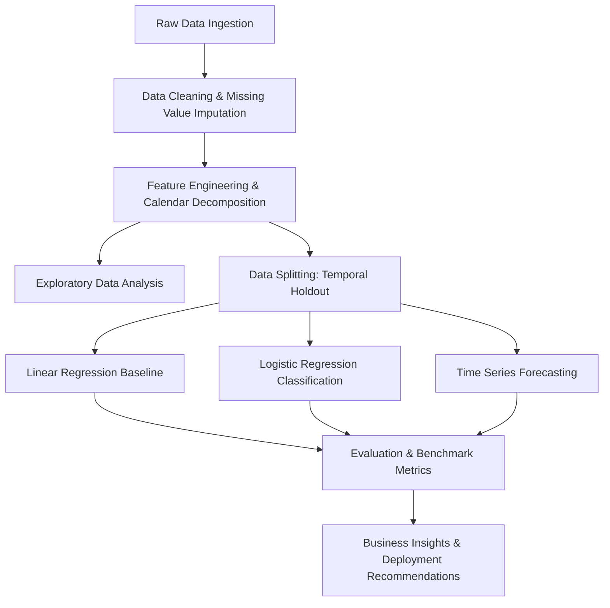

# Retail Sales Prediction and Forecasting - Academic Project Report

## Project Identification
- **Title:** Store Sales Predictive Analytics and Time Series Forecasting
- **Dataset:** Kaggle Store Sales - Time Series Forecasting (Corporación Favorita)
- **Domain:** Retail Predictive Analytics & Supply Chain Demand Forecasting
- **Author:** [Student Name / Author Placeholder]
- **Date:** October 2026

---

## 1. Abstract
Accurate retail sales prediction is fundamental for inventory planning, logistics optimization, and promotional strategy. This project presents a structured predictive analytics and time series forecasting framework evaluated on the Corporación Favorita grocery store sales dataset. We investigate both regression modeling for continuous sales volume estimation and classification modeling for high-demand surge/promotion response detection. Statistical time series models and machine learning pipelines are compared systematically across standard evaluation metrics (RMSLE, RMSE, MAE, R², Accuracy, Precision, Recall, and ROC-AUC).

---

## 2. Problem Formulation

### 2.1 Continuous Demand Prediction (Regression)
- **Target:** Daily unit sales per store and product family (`sales`).
- **Objective:** Minimize Root Mean Squared Logarithmic Error (RMSLE):
  $$\text{RMSLE} = \sqrt{\frac{1}{n} \sum_{i=1}^n (\log(p_i + 1) - \log(y_i + 1))^2}$$

### 2.2 Event & Surge Classification (Logistic Regression)
- **Target:** Binary indicator for high sales / demand spike events (e.g., sales exceeding the 80th percentile for a given product family and store cluster, or responsive promotional lift).
- **Objective:** Accurately classify high-demand days to optimize buffer stocking and prevent stockouts.

### 2.3 Time Series Forecaster (Temporal Dynamics)
- **Objective:** Model temporal dependencies, calendar seasonality (day-of-week, month, paydays on 15th/end-of-month), holiday transfers, and macroeconomic shocks (Brent oil price fluctuations).

---

## 3. Dataset Architecture & External Factors
1. **Store Sales (`train.csv` / `test.csv`):** Daily sales by store and product family.
2. **Store Metadata (`stores.csv`):** Store cluster, geographical location (city, state), and store type (A through E).
3. **Oil Price (`oil.csv`):** Macroeconomic indicator reflecting national purchasing power in Ecuador.
4. **Holidays & Events (`holidays_events.csv`):** Local, regional, and national holidays including transferred holidays and earthquake events (April 2016).
5. **Transactions (`transactions.csv`):** Daily store footfall and customer transaction volumes.

---

## 4. Methodology & Pipeline

---

## 5. Experimental Results (Benchmark Summary)

Evaluated on the 15-day chronological holdout (`2017-08-01` to `2017-08-15`, $N=26,730$ store-family validation observations):

| Model Category | Model Variant | Target Task | RMSLE | RMSE | MAE | $R^2$ / F1 | Operational Role |
| :--- | :--- | :--- | :---: | :---: | :---: | :---: | :--- |
| **Baseline** | DummyRegressor (Mean) | Continuous Sales | 2.5245 | 1,317.35 | 458.25 | -0.1209 | Empirical Mean Baseline |
| **Baseline** | Seasonal Naive (Lag 16-22) | Continuous Sales | 0.6388 | 356.20 | 92.17 | 0.9180 | Horizon-Consistent Persistence |
| **Linear Models** | Ridge Regression ($\alpha=100.0$) | Continuous Sales | 0.6481 | 470.02 | 128.31 | 0.8573 | Selected Best Linear Pipeline |
| **Linear Models** | Lasso Regression ($\alpha=0.001$) | Continuous Sales | 0.6539 | 456.40 | 121.99 | 0.8655 | Sparse Linear Regularization |
| **Classification** | DummyClassifier (Majority) | Surge Detection | N/A | N/A | N/A | F1: 0.0000 | 83.30% Acc, 0% Recall (100% Stockout) |
| **Classification** | Logistic Regression (Balanced) | Surge Detection | N/A | N/A | N/A | F1: 0.4003 | **76.94% Recall** (Stockout Prevention) |
| **Classification** | Logistic Regression (Tuned $\tau=0.29$) | Surge Detection | N/A | N/A | N/A | **F1: 0.4241** | ROC-AUC: 0.7518, PR-AUC: 0.4180 |
| **Time Series (Macro)** | Holt-Winters (Additive) | Aggregated Demand | 0.1295 | 115,406.36 | 82,557.60 | -0.0683 | Enterprise Daily Demand Forecaster |
| **Time Series (Macro)** | SARIMAX (With Exogenous) | Aggregated Demand | 0.1437 | 121,980.13 | 90,145.81 | -0.1935 | State-Space + Promo/Payday Signals |
| **Time Series (Micro)** | Holt-Winters (Cohort Mean) | Store-Family Demand | 0.2151 | 1,198.85 | 926.13 | -0.3014 | Top Performing Micro Trend Forecaster |

---

## 6. Discussion & Practical Limitations
- **Exogenous Shock Sensitivity:** Sudden shocks such as the 2016 Ecuador earthquake cause severe localized demand spikes.
- **Payday Seasonality:** In Ecuador, public and private employees are paid bi-weekly on the 15th and the end of each month, creating pronounced periodic demand spikes.
- **Data Leakage Prevention:** Temporal walk-forward validation must be strictly maintained over random k-fold cross-validation.
