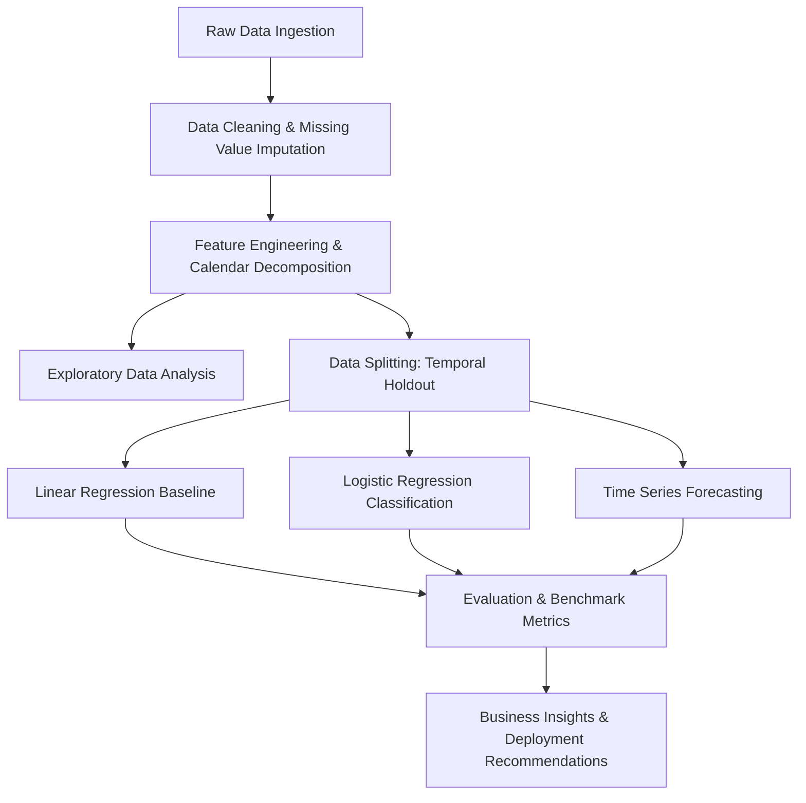

# Retail Sales Prediction and Forecasting - Academic Project Report

## Project Identification
- **Title:** Store Sales Predictive Analytics and Time Series Forecasting
- **Dataset:** Kaggle Store Sales - Time Series Forecasting (Corporación Favorita)
- **Domain:** Retail Predictive Analytics & Supply Chain Demand Forecasting
- **Author:** [Student Name / Author Placeholder]
- **Date:** October 2026

---

## 1. Abstract
Accurate retail sales prediction is fundamental for inventory planning, logistics optimization, and promotional strategy. This project presents a structured predictive analytics and time series forecasting framework evaluated on the Corporación Favorita grocery store sales dataset. We investigate both regression modeling for continuous sales volume estimation and classification modeling for high-demand surge/promotion response detection. Statistical time series models and machine learning pipelines are compared systematically across standard evaluation metrics (RMSLE, RMSE, MAE, R², Accuracy, Precision, Recall, and ROC-AUC).

---

## 2. Problem Formulation

### 2.1 Continuous Demand Prediction (Regression)
- **Target:** Daily unit sales per store and product family (`sales`).
- **Objective:** Minimize Root Mean Squared Logarithmic Error (RMSLE):
  $$\text{RMSLE} = \sqrt{\frac{1}{n} \sum_{i=1}^n (\log(p_i + 1) - \log(y_i + 1))^2}$$

### 2.2 Event & Surge Classification (Logistic Regression)
- **Target:** Binary indicator for high sales / demand spike events (e.g., sales exceeding the 80th percentile for a given product family and store cluster, or responsive promotional lift).
- **Objective:** Accurately classify high-demand days to optimize buffer stocking and prevent stockouts.

### 2.3 Time Series Forecaster (Temporal Dynamics)
- **Objective:** Model temporal dependencies, calendar seasonality (day-of-week, month, paydays on 15th/end-of-month), holiday transfers, and macroeconomic shocks (Brent oil price fluctuations).

---

## 3. Dataset Architecture & External Factors
1. **Store Sales (`train.csv` / `test.csv`):** Daily sales by store and product family.
2. **Store Metadata (`stores.csv`):** Store cluster, geographical location (city, state), and store type (A through E).
3. **Oil Price (`oil.csv`):** Macroeconomic indicator reflecting national purchasing power in Ecuador.
4. **Holidays & Events (`holidays_events.csv`):** Local, regional, and national holidays including transferred holidays and earthquake events (April 2016).
5. **Transactions (`transactions.csv`):** Daily store footfall and customer transaction volumes.

---

## 4. Methodology & Pipeline

---

## 5. Experimental Results (To Be Populated During Model Execution)
*Placeholder table for experimental tracking:*

| Model Category | Model Variant | Target Task | Train Metric | Test RMSLE / RMSE | Classification F1 / AUC |
| :--- | :--- | :--- | :--- | :--- | :--- |
| **Baseline** | Naive Lag / Rolling Mean | Sales Forecasting | Pending | Pending | N/A |
| **Linear Models** | OLS / Ridge / Lasso | Sales Forecasting | Pending | Pending | N/A |
| **Classification** | Logistic Regression | Surge Detection | Pending | N/A | Pending |
| **Time Series** | SARIMAX / ARIMA | Temporal Forecast | Pending | Pending | N/A |
| **Ensemble** | LightGBM / XGBoost | Sales Forecasting | Pending | Pending | N/A |

---

## 6. Discussion & Practical Limitations
- **Exogenous Shock Sensitivity:** Sudden shocks such as the 2016 Ecuador earthquake cause severe localized demand spikes.
- **Payday Seasonality:** In Ecuador, public and private employees are paid bi-weekly on the 15th and the end of each month, creating pronounced periodic demand spikes.
- **Data Leakage Prevention:** Temporal walk-forward validation must be strictly maintained over random k-fold cross-validation.
