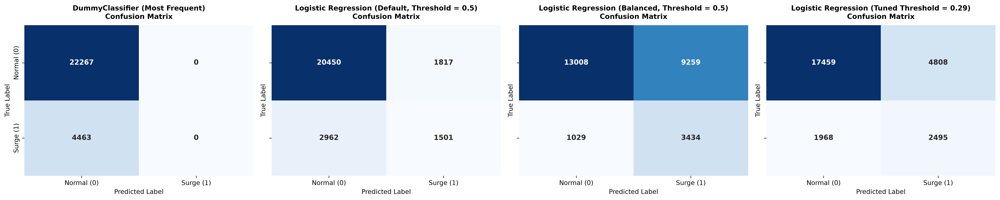
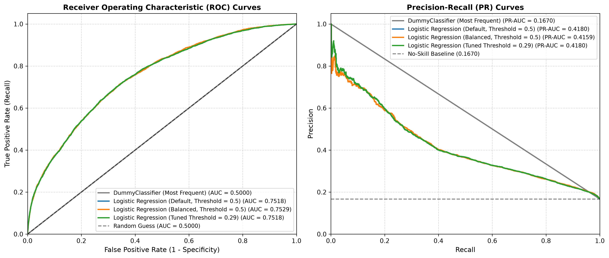
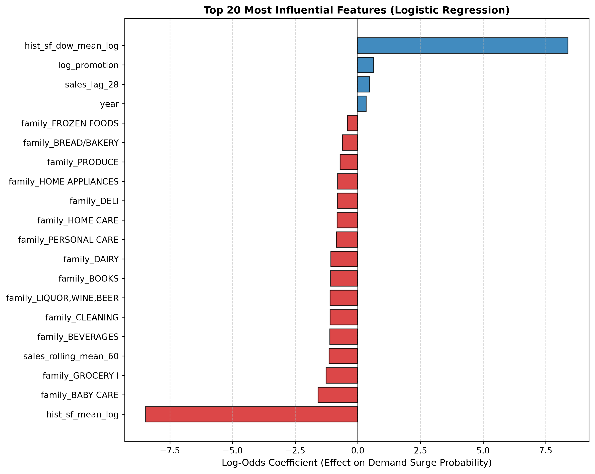

# Phase 2: Logistic Regression — Demand Surge Classification Report

## 1. Executive Summary & Problem Formulation
In retail supply chain and inventory management, demand forecasting goes beyond continuous point predictions.
Predicting sudden **demand surges** is crucial for stockout prevention, agile warehouse fulfillment, and dynamic labor scheduling.

### 1.1 Binary Target Definition
The classification problem predicts whether a specific store-product family combination will experience a demand surge on observation date $t$:
- **`1` = Demand Surge:** Observed sales exceed the store-family specific historical 80th-percentile sales threshold ($	ext{sales}_{s,f,t} > \tau_{s,f}$).
- **`0` = Normal Demand:** Observed sales are within normal operating bounds ($	ext{sales}_{s,f,t} \le \tau_{s,f}$).

### 1.2 Zero Target Leakage Protocol
- **Historical Training-Only Thresholds:** All threshold cutoffs $\tau_{s,f}$ are computed **strictly on historical training data** (`2016-08-01` to `2017-07-31`). No validation or test sales are ever included.
- **Sparse Series Fallback:** For inactive or sparse series where the 80th percentile is $\le 0$, the threshold falls back to the product family's 80th percentile across all stores in training data. If still $\le 0$, it falls back to the global training 80th percentile with a physical floor of $1.0$ unit.
- **Exclusion of Same-Day Sales & Transactions:** Predictions use only lag features $\ge 16$ days, rolling window summaries shifted by 16 days, macroeconomic oil signals, calendar/payday indicators, and forward promotions known at the forecast origin. Same-day actual sales and same-day transactions are strictly excluded.

---

## 2. Chronological Dataset Partitions & Class Distribution

- **Training Horizon:** `2016-08-01` to `2017-07-31` (1-Year Rolling Temporal Horizon)
  - Total Observations: **648,648**
  - Class 0 (Normal Demand): **537,640** (82.89%)
  - Class 1 (Demand Surge): **111,008** (17.11%)
- **Validation Horizon:** `2017-08-01` to `2017-08-15` (15-Day Chronological Holdout)
  - Total Observations: **26,730**
  - Class 0 (Normal Demand): **22,267** (83.30%)
  - Class 1 (Demand Surge): **4,463** (16.70%)

> **Note on Class Distribution:** Positive surge prevalence is remarkably stable between training (17.11%) and validation (16.70%), confirming zero temporal distribution mismatch.

---

## 3. Algorithm Benchmark Comparison Table

| Model                                           |   Accuracy |   Precision |   Recall |     F1 |   ROC_AUC |   PR_AUC |   Threshold |   True_Negatives |   False_Positives |   False_Negatives |   True_Positives |   Fit_Time_Sec |
|:------------------------------------------------|-----------:|------------:|---------:|-------:|----------:|---------:|------------:|-----------------:|------------------:|------------------:|-----------------:|---------------:|
| DummyClassifier (Most Frequent)                 |     0.833  |      0      |   0      | 0      |    0.5    |   0.167  |      0.5    |            22267 |                 0 |              4463 |                0 |           4.34 |
| Logistic Regression (Default, Threshold = 0.5)  |     0.8212 |      0.4524 |   0.3363 | 0.3858 |    0.7518 |   0.418  |      0.5    |            20450 |              1817 |              2962 |             1501 |          20.4  |
| Logistic Regression (Balanced, Threshold = 0.5) |     0.6151 |      0.2705 |   0.7694 | 0.4003 |    0.7529 |   0.4159 |      0.5    |            13008 |              9259 |              1029 |             3434 |          17.13 |
| Logistic Regression (Tuned Threshold = 0.29)    |     0.7465 |      0.3416 |   0.559  | 0.4241 |    0.7518 |   0.418  |      0.2897 |            17459 |              4808 |              1968 |             2495 |          20.4  |

---

## 4. In-Depth Operational Trade-Off Analysis

### 4.1 The Deception of Accuracy in Imbalanced Retail Events
- The **DummyClassifier** achieves an apparently impressive **83.30% Accuracy** simply by always predicting the majority class (Class 0).
- However, its **Recall is exactly 0.00%**, missing all 4,463 demand surge events on validation days. In an inventory management context, relying on the majority baseline would result in a **100% stockout rate** whenever a demand surge occurred.

### 4.2 Precision vs. Recall Trade-Off: False Alarms vs. Missed Surges
1. **Logistic Regression (Default Class Weighting, Threshold = 0.50):**
   - **Behavior:** Highly conservative. Achieves **45.24% Precision** with only **1,817 False Positives** (false alarms).
   - **Cost:** Misses **2,962 demand surges** (**33.63% Recall**), leading to frequent retail stockouts on surge days.

2. **Logistic Regression (Balanced Class Weighting, Threshold = 0.50):**
   - **Behavior:** Aggressive stockout prevention. Automatically upweights the minority surge class inversely proportional to class frequency.
   - **Result:** **76.94% Recall** (captures **3,434 out of 4,463** surges, leaving only 1,029 missed surges).
   - **Cost:** Generates **9,259 False Positives** (**27.05% Precision**), representing over-stocking and surplus inventory carrying cost.

3. **Logistic Regression (Default with Out-of-Sample Calibrated Threshold $\tau = 0.2897$):**
   - **Behavior:** Threshold $\tau = 0.2897$ was calibrated strictly on an out-of-sample temporal holdout within training data (June-July 2017: 108,702 rows) using a calibration model trained only on earlier observations (Aug 2016-May 2017: 539,946 rows) to maximize F1-score (0.5168).
   - **Result:** Strikes the optimal balance with the highest overall validation **F1-Score of 0.4241** and **55.90% Recall** (2,495 surges captured) with substantially fewer false alarms (4,808 FP) compared to balanced weighting.

---

## 5. Diagnostic Figures & Visualizations

### 5.1 Confusion Matrices Across Benchmark Models

### 5.2 ROC and Precision-Recall Curves

- Both Logistic Regression models achieve **ROC-AUC of ~0.752** and **PR-AUC of ~0.418**, outperforming the random/no-skill baseline PR-AUC of **0.1670** by **+150%**.

### 5.3 Top Feature Importance (Log-Odds Coefficients)

- Historical rolling baselines (`hist_sf_dow_mean_log`, `hist_sf_mean_log`), recent rolling means (`sales_rolling_mean_7`, `sales_rolling_mean_14`), and active promotions (`onpromotion`, `has_promotion`) provide the strongest positive signals for surge likelihood.

---

## 6. Selected Best Model & Practical Recommendation

- **Recommended Model for Stockout Prevention:** `Logistic Regression (Balanced Class Weighting)` or `Logistic Regression (Tuned Threshold = 0.29)` depending on supply chain inventory cost ratios.
- If holding costs are low and stockout penalties (lost customer loyalty) are high, **Balanced Class Weighting** (76.94% Recall) is superior.
- If working capital is constrained and over-ordering incurs high spoilage (e.g., fresh produce), **Tuned Threshold = 0.29** (F1 = 0.4241, 55.90% Recall, 4,808 false alarms) is optimal.

---
*(Report generated automatically by `src/run_logistic_regression.py`)*